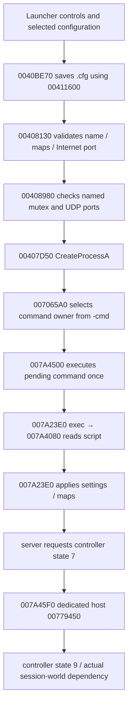

# Dedicated server architecture and N0 result — 2026-11-09

N0 is static research, not delivery. Source checkpoints and runtime acceptance
are tracked separately in [plan](plan.md), [handoff](HANDOFF.md) and the networking
ledger. The main P2.2 files and frozen client/LS3DF ledger are unchanged.

## Inputs and provenance

Authorized installation, read only:
`/home/control/Documents/Projects/H&D2 Decomp 4/Hidden and Dangerous 2`.
No replacement download, original program execution, patch or installation write.
The networking worktree was already clean on `feature/networking`, at local
master d8b64f8; no branch reset, fetch or main-worktree mutation was needed.

| Image | SHA256 | Static identity |
| --- | --- | --- |
| HD2DS.exe | 48ba25814ab429fed4418d8610b2eca5aaeb594d83a29a0ca6b99fa152f1c152 | PE32 i386 GUI, base 00400000, entry 008252E1, 5,214,242 bytes |
| ServerLauncher.exe | 6ed896ce1b468b04ce3d0136f9d4b51340c648838bd9a2eb34761cc2a1c96fbb | PE32 i386 GUI, base 00400000, entry 0041550F, 241,664 bytes |

Neither image has a PE fixed file/product version resource. Do not invent a
launcher version from its timestamp. Server initialized globals 00885C90/94 are
major/minor 1/12; the hosting banner 00779450 and admission callback 0077DCF0 use
them. [PE manifest](binary-manifest.json) records full imports, section sizes,
COFF timestamps and local headless-engine/archive DLL fingerprints.

Server imports USER32, ole32, ADVAPI32, GDI32, OLEAUT32, WINMM, **LS3DRF**,
rw_data, MPR, imagehlp, WSOCK32 and KERNEL32. The headless engine is distinct
from the client's LS3DF; it is not new recovery credit. Launcher imports
KERNEL32, USER32, ole32, COMCTL32 and WS2_32. It has no direct registry imports.
Winsock imports alone do not identify the session transport: server COM call
sites establish DirectPlay8Server hosting; auxiliary UDP/GameSpy paths coexist.
Imported runtime/API availability under Windows/Proton remains untested.

Independent Ghidra 12.2 projects (Java 25, max CPU 2, 2 GiB heap) are local under
ignored `analysis/work/networking/ghidra-projects/{LauncherResearch,ServerResearch}`.
Imported original files directly; loaded zero additional DLLs. Their executable
hashes match the input fingerprints. No existing Ghidra project was edited.
Subsequent exports use `-readOnly -noanalysis`; transient signature models are
discarded. Inventories were captured before these models:

| Census | Internal non-thunk | Internal thunk | External | Total |
| --- | ---: | ---: | ---: | ---: |
| [Server](server-inventory.json) | 13,957 | 6,591 | 256 | 20,804 |
| [Launcher](launcher-inventory.json) | 849 | 13 | 109 | 971 |

Counts include unidentified library/runtime code, not an established game/library
split. Analysis may miss functions or boundaries; no completion claim follows
from a census. Internal JMP thunks are numerous in this server build. Preserve
canonical targets as well as thunk provenance when following client parallels.

## Launcher → server configuration

* Launcher entry 0041550F → 0040CBE0 initializes/shuts down its UI owner.
  00408FB0 reads `ServerLauncher.dat` through its localization loader. This is
  **localization**, not the server settings file.
* 004075C0 makes `<game directory>\ServerConfigs\<selected filename>`.
  00407670 obtains that filename from list control 042B. 0040BE70 saves current
  controls to that path using 00411600 before Start continues through 0040C010.
* 00411600 serializes session name, style, repeated mapname entries, rules,
  domain, optional Internet port, limits/voice, optional password/admin strings,
  autorestart/co-op rules, and the fixed tail `dedicated 1` then `server`.
  It is a console command script, not the client's chunked MPSetingsOrig.sav.
  00412720/00411F50 read launcher configuration; semicolon-led lines are comments.
* 00408130 requires a nonempty session name and map vector, checks maps against
  selected style, and bounds Internet port to **2000..65531**. 00408980 probes a
  named mutex and calls 00406030 for **four consecutive UDP ports** in Internet
  mode. 00408460 handles base-game/co-op map warnings separately.
* 00407C90 chooses `<game directory>\HD2DS.exe` or
  `HD2DS_SabreSquadron.exe` from control 0451. This workstream fingerprints the
  base HD2DS image; expansion behavior receives no implied coverage.
* 00407D50 uses explicit application path, mutable command string
  **` -cmd -exec <full configuration path>`**, no inherited handles, flags 0,
  inherited environment and **game directory as current directory**. The
  command string begins with a space and does not prepend the executable name.
  Server uses GetCommandLineA substring scanning rather than CRT argv parsing.
  No quoting is added around the filename. Exec consumes the remaining path,
  so spaces must not be treated as argument delimiters in this special branch.
* Launch failure uses GetLastError/FormatMessageA and localized reporting.
  This call path does not wait for server initialization or prove startup.
  No settings handoff through registry, pipe or shared memory was found here.
  Mutex probing is instance coordination, not a settings payload. This bounded
  conclusion does not assert that all other server features avoid registry use.

Client alternative: 007226B0 → 006ACF50 writes `XDServer_%5d.txt` and launches
`hd2ds.exe -cmd -exec filename`. This shares server console ingestion but is
independent of the external launcher's UI/config persistence.

## Server startup and network ownership

* CRT 008252E1 → thunk 0040CA13 → WinMain 00725FA0 sets process/thread priority.
  `-autorestart` selects supervisor 007AACE0; ordinary startup enters 00725850.
  007AAFB0 starts the autorestart companion. Supervisor details remain research,
  not an independently working restart facility.
* 00725850 creates a manual-reset event and application owner 00706120, calls
  00725260 bootstrap and 00706250 initialization, then runs Win32 dispatch,
  engine tick, network queues and controller update. It is not a simple socket
  accept loop. 00725260 includes COM, TEV/bootstrap and required engine/settings
  initialization. Protection/setup/bootstrap calls remain unresolved source
  dependencies and cannot be replaced with successful no-ops.
* 007065A0 searches for literal ` -cmd ` in GetCommandLineA and stores the tail
  in console owner 007A43A0. Alternate `-exec` mode and interactive console exist.
  007A4500 executes the pending command once; 007A23E0 dispatches the 0x204-byte
  keyword table at 00886F78. `exec` → 007A4080 opens a text file and dispatches
  lines. The parser is 007A47B0; separator-only advancement is 007A4990.
* `server` (keyword 35) requires a nonempty map rotation and idle mode, assigns
  configuration mode 2 and requests controller status 7. 007A45F0 checks
  dedicated flag +170, calls host 00779450, then requests status 9. Its ignored
  host result must not be mistaken for a successful application session.
* 00779450 closes previous work through 007882B0; initializes COM; creates
  DirectPlay8Server (CLSID 00858F80, IID 00858F30); installs callback thunk
  **0040C6A8 → 0077DCB0 → 0077DCF0** against global owner 009D6870; enumerates
  providers; creates TCP/IP address and invokes Host. It retains HRESULT and
  textual error fields +504C/+5050 and releases acquired interfaces on failure.
  Actual argument and partial-acquisition cleanup fidelity need focused N1 work:
  decompiler stack recovery alone cannot certify each indirect COM call.
* Application GUID bytes at 008560E8 match the client GUID
  `{2ae5b082-cfa0-11d4-9e1d-0050fc213de6}`. LAN advertises 31567; Internet uses
  configured +220. Optional voice 0077B590 uses original codec GUID selection.
  Internet GameSpy 0077AB40 initializes query/registration service with port
  +220 **+3**, `hd2` and the original SDK secret. Other auxiliary owners remain
  separate; do not extrapolate all port responsibilities from the four-port probe.
* 00779F30 creates additional session/compression/serialization state, not merely
  an advertisement. Queue/network pumps run alongside the actual owner lifecycle.
  Exact timeout, teardown and malformed-message ownership require N1/N3 recovery.

## Discovery and admission evidence

0077DCB0 dispatches server callbacks only with host mode bit 1. In 0077DCF0:

* `ENUM_HOSTS_QUERY` FFFF000A refuses with -1 unless actual game owner 006D90A0
  exists and progress +28 >= 100. Its response writes query kind/map/version,
  style, dedicated flag, capacity/player count, password/port/voice and optional
  information. This agrees with the independently recovered client bit decoder.
* `INDICATE_CONNECT` FFFF000E requires exactly **0x54 bytes**, non-null input,
  matching DWORD major/minor at +14/+18, available player capacity and a matching
  password. Rejection reply byte 7 is incompatible data/version, 3 full, 4 wrong
  password. Later checks and reservations must be recovered before acceptance
  can safely be reconstructed; an isolated prefix is not complete admission.
* CREATE_PLAYER/DESTROY_PLAYER FFFF0007/0009 manage the owned 0xC4 player vector,
  transport IDs, critical sections and queued session notifications.
* RECEIVE/RETURN_BUFFER/TERMINATE and completion paths share borrowed API buffers
  and owned allocations. Their whole lifetime contract remains open.

The existing client's [review](client-boundary.md) and [provider comparison](discovery-providers.md)
establish what can be reused and what needs implementation. No network endpoint
was contacted for interoperability; no session or successful query is claimed.

## Next reconstruction boundary and concrete dependencies

First source checkpoint: reconstruct bounded launcher text configuration, exact
launch specification and server command tokenization, with native malformed/
length/repeat checks and strict Windows i386 compilation. Preserve launcher enum
orders (style objectives/occupation/deathmatch/cooperative; domain internet/local;
codec none/vr12/sc03/sc06/truespeech/gsm/adpcm/pcm) separately from server values.
Do not share their numeric ordinals accidentally.

After that: actual server settings dispatch and startup owner, DirectPlay service
acquisition/cleanup, session reservation/acceptance, UDP helpers and real readiness
dependencies. Full original server path requires headless engine/bootstrap and
world/session state absent from this workstream's independently compiled server.
That is a concrete dependency to recover, not permission to fake readiness or
expand into multiplayer gameplay. Genuine session acceptance still needs an
approved user-operated client/server test.

## Local evidence record

Ignored `analysis/work/networking/`: import logs, raw inventory JSON, complete
section-mapped objdump assembly, defined-string/import cross references and
fingerprinted ExportFunctions C/JSON directories `launcher-startup`,
`launcher-config`, `launcher-contract`, `server-startup`, `server-command`,
`server-lifecycle`, `server-owners`. Only existing, successfully decompiled JSON/C
pairs are evidence. Two exploratory exports ended at undefined requested entries;
those missing entries are not evidence or reconstructed functions. A script-path
class-loading failure was corrected with a flat ignored script staging directory.
Ghidra imports logged missing PDB/debug information and two speculative-address
decompiler warnings; census metadata is not validation of those bodies. Subsequent
read-only source contracts use inspected call sites and transient signature fixes.
No commercial code exports or executables are tracked; inventories contain only
function metadata. Reproduction commands and receipt hashes accompany checkpoints.
